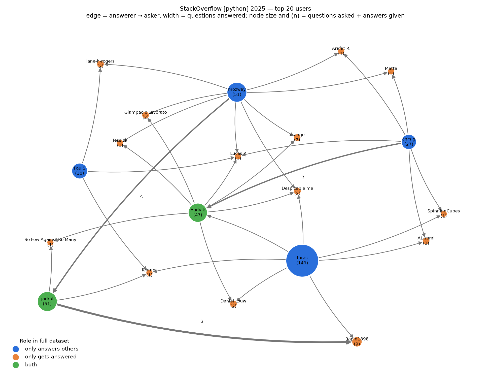
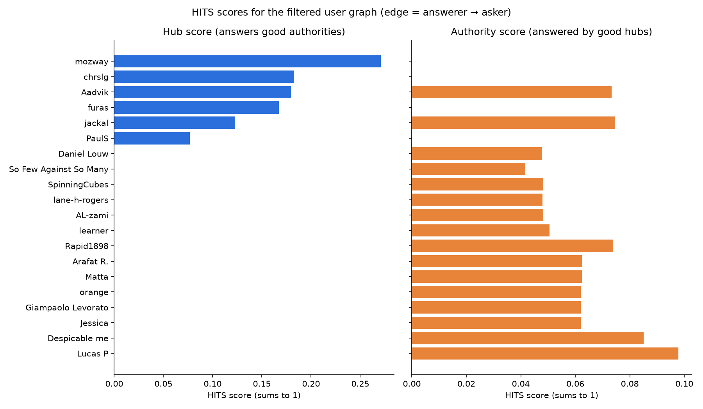

# Week 11: Centrality and interpretation

Data: 2,465 `[python]` questions from 2025 that have an accepted answer, plus their 3,452 answers (after cleaning). Graph: users are nodes, and an edge **u → v** means *u answered a question asked by v*. Edge weight is the number of v's questions that u answered. Self-answers are excluded.

Reproduce with `python src/graph.py` and then `python src/centrality.py`. Numbers below are from `data/centrality.csv`.

## The whole network first

| | |
|---|---|
| Users | 2,920 (1,789 only get answered, 1,076 only answer others, 55 do both) |
| Edges (distinct answerer → asker pairs) | 2,906 |
| Pairs with more than one interaction | 59 (2%) |
| Reciprocal pairs (A answered B *and* B answered A) | 0 |
| Largest weakly connected component | 1,907 users (65%) |
| Share of answers given by the top answerer / top 20 answerers | 5% / 23% |
| Answerers who answered exactly once | 769 of 1,131 (68%) |

So the "classroom" is very lopsided. Most askers show up once, get help, and leave. Most answerers answer once. A small group of regulars carries a large share of the load. Nobody helps someone who has helped them, so there is no peer-to-peer exchange. Help flows one way, from experts to newcomers.

## How the 20 nodes were chosen

A plain "top 20 most active users" filter returns 20 answerers with only 3 edges between them, because frequent answerers rarely answer *each other*. Instead, `select_top_nodes` grows a connected subgraph from the busiest user and always adds the neighbour with the most links into the group. This keeps the densest corner of the network: 6 regular answerers plus the 14 askers they have in common (35 edges). The trade-off is that the selection favours askers who were helped by **several** regulars. Their authority scores are therefore all fairly similar, and the scores describe this neighbourhood, not the whole site. The last two columns of the table below give full-graph HITS ranks for comparison.

## Centrality table (filtered 20-node graph)

In / out = distinct users. "(w)" = weighted by number of questions. Hub and authority are weighted HITS scores, each normalised to sum to 1. Full-graph ranks are out of 2,920 users.

| User | Role | In | Out | In (w) | Out (w) | Hub | Authority | Full hub rank | Full auth. rank |
|---|---|---|---|---|---|---|---|---|---|
| mozway | answerer | 0 | 9 | 0 | 10 | **0.271** | 0 | 21 | – |
| chrslg | answerer | 0 | 6 | 0 | 7 | 0.182 | 0 | 6 | – |
| Aadvik | both | 2 | 7 | 3 | 7 | 0.180 | 0.073 | 17 | **7** |
| furas | answerer | 0 | 7 | 0 | 7 | 0.167 | 0 | **1** | – |
| jackal | both | 1 | 3 | 2 | 5 | 0.123 | 0.075 | **2** | 237 |
| PaulS | answerer | 0 | 3 | 0 | 3 | 0.077 | 0 | 36 | – |
| Lucas P | asker | 4 | 0 | 4 | 0 | 0 | **0.098** | – | 166 |
| Despicable me | asker | 3 | 0 | 3 | 0 | 0 | 0.085 | – | 16 |
| Rapid1898 | asker | 2 | 0 | 4 | 0 | 0 | 0.074 | – | **5** |
| Arafat R. | asker | 2 | 0 | 2 | 0 | 0 | 0.062 | – | 235 |
| Matta | asker | 2 | 0 | 2 | 0 | 0 | 0.062 | – | 232 |
| orange | asker | 2 | 0 | 2 | 0 | 0 | 0.062 | – | 282 |
| Giampaolo Levorato | asker | 2 | 0 | 2 | 0 | 0 | 0.062 | – | 284 |
| Jessica | asker | 2 | 0 | 2 | 0 | 0 | 0.062 | – | 157 |
| learner | asker | 3 | 0 | 3 | 0 | 0 | 0.051 | – | 11 |
| AL-zami | asker | 2 | 0 | 2 | 0 | 0 | 0.048 | – | 18 |
| SpinningCubes | asker | 2 | 0 | 2 | 0 | 0 | 0.048 | – | 23 |
| lane-h-rogers | asker | 2 | 0 | 2 | 0 | 0 | 0.048 | – | 323 |
| Daniel Louw | asker | 2 | 0 | 2 | 0 | 0 | 0.048 | – | 34 |
| So Few Against So Many | asker | 2 | 0 | 2 | 0 | 0 | 0.042 | – | 161 |

("–" means a zero score, which puts the user in a tie at the bottom of the full-graph ranking.)

## What the measures mean here

Because edges point from answerer to asker:

- **Out-degree** counts how many different people a user has helped. It measures how much a user *teaches*.
- **In-degree** counts how many different people have helped a user. It measures how much a user *gets taught*, or how many perspectives their questions attract.
- A **hub** is a user who answers people who are themselves answered by other strong hubs. In this network that means an expert who works on the "busy" questions that several experts are involved in.
- An **authority** is a user who gets answered by strong hubs. In this network that means an asker whose questions draw the top answerers. It does **not** mean "expert", which is the opposite of how "authority" reads on the web. This is the most important point to keep in mind when reading the scores.

## Interpretation

1. **The network splits cleanly into teachers and learners.** Fourteen of the 20 nodes have out-degree 0, and four of the six regulars have in-degree 0. Hub and authority scores are almost perfectly complementary. 18 of the 20 users have a non-zero score on only one of the two, and the only exceptions are the two "both" users discussed in point 3. That is what a one-directional help network looks like, and it matches the absence of reciprocal pairs in the full data.

2. **mozway is the strongest hub in this neighbourhood, but furas is the strongest hub overall.** In the 20-node view, mozway has the highest out-degree (9) and hub score (0.271), because mozway answered many of the same askers as the other regulars. In the full graph, furas has by far the highest out-degree: 143 different users, about 5% of all answers. furas is also hub #1, while mozway falls to #21. furas helps a huge number of people who usually get no other answer, so few of those askers appear in a "shared askers" subgraph. The difference shows that **degree measures volume, while HITS measures where in the network that volume lands.**

3. **Aadvik and jackal are the "bridge" learners.** They are the only nodes in the subgraph that both ask and answer. Aadvik has in-degree 2 (answered by chrslg and furas) and out-degree 7, and is full-graph authority #7 and hub #17. jackal is full-graph hub #2 and is also answered by mozway. In a classroom, these are the students who have moved from asking to helping others while still asking themselves. They are the clearest example of learning happening over time in this network.

4. **Lucas P is the top authority because four different regulars answered them** (mozway, chrslg, PaulS and Aadvik), which gives them the highest in-degree in the subgraph. Rapid1898 has the same weighted in-degree (4), but three of those answers come from one person (jackal). Rapid1898 therefore ranks lower in the subgraph, yet #5 in the full graph, because jackal is a very strong hub there. **Authority rewards being answered by many different strong hubs, not just receiving many answers.**

5. **Repeated tutoring is rare.** Only 2% of pairs interact more than once. In the subgraph only three edges have weight above 1: jackal → Rapid1898 (3), mozway → jackal (2) and chrslg → Aadvik (2). These are the closest the network comes to an ongoing tutor and student relationship.

## Limitations

- One tag and one year, and only questions with an accepted answer. Questions that went unanswered are not in the network, so struggling askers are under-represented.
- The 20-node selection shapes the hub and authority values (see point 2), so the full-graph ranks are included alongside them.
- Comments are not counted. A lot of informal help on StackOverflow happens in comments.
